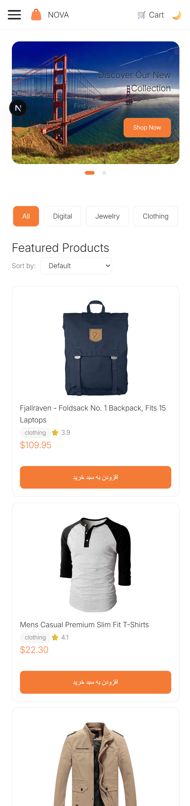
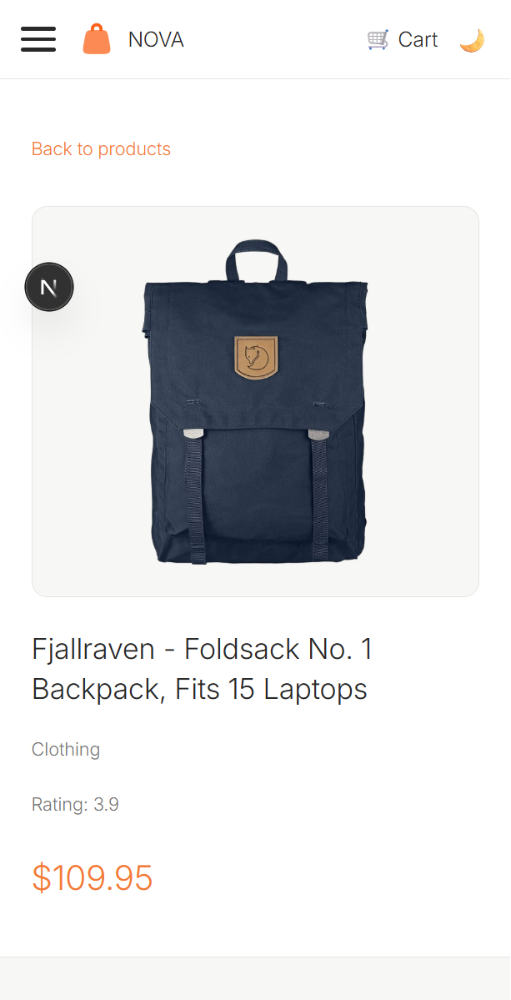
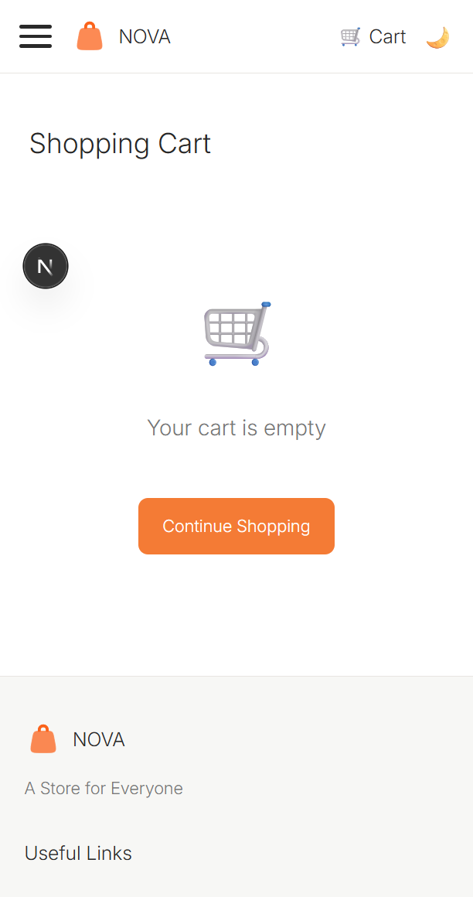

# NOVA Store

NOVA is a responsive storefront built with Next.js, React, and TypeScript. It uses the [Fake Store API](https://fakestoreapi.com/) for its product catalog and supports English and Persian interfaces.

## Features

- Server-rendered product catalog and product detail pages
- Product category filters, sorting, pagination, and search
- Shopping cart with quantity controls and browser storage persistence
- Light and dark themes
- English (left-to-right) and Persian (right-to-left) localization
- Product metadata for sharing and search engines

## Prerequisites

- Node.js 20.9 or later
- npm (included with Node.js)

## Getting started

Clone the repository and install the locked dependencies:

```bash
git clone https://github.com/pourghasemi/novaStore.git
cd novaStore
npm ci
```

Create a local environment file from the example:

```bash
cp .env.example .env.local
```

In PowerShell, use `Copy-Item .env.example .env.local` instead. The example configures:

| Variable | Purpose |
| --- | --- |
| `NEXT_PUBLIC_API_BASE_URL` | Fake Store API base URL |
| `NEXT_PUBLIC_SITE_URL` | Canonical site URL used for metadata, sitemap, and robots |

Start the development server and open [http://localhost:3000](http://localhost:3000):

```bash
npm run dev
```

The app's default locale is English. Use `/en` for English and `/fa` for Persian.

## Commands

| Command | Description |
| --- | --- |
| `npm run dev` | Start the Next.js development server |
| `npm run lint` | Run ESLint |
| `npm run build` | Create a production build |
| `npm run start` | Serve the production build (run `npm run build` first) |

## Pages

- `/[locale]` — storefront with product browsing, filters, sorting, and pagination
- `/[locale]/products/[id]` — product details
- `/[locale]/cart` — shopping cart

## Server-side rendering (SSR)

Next.js renders the home and product detail routes on the server. The server fetches product data from Fake Store API before returning the page, so the initial HTML already contains the catalog or product details. This improves initial content delivery and makes product pages available to search crawlers. Product detail metadata is also generated from the product data; the request-scoped React cache avoids duplicate fetches when the page and its metadata need the same product.

Interactive pieces such as filters, cart controls, and theme controls are client components. The server-rendered output is hydrated in the browser so those controls become interactive. The cart is client-side state and is persisted in the browser; it is not part of the server-side product fetch.

## Why Zustand?

Zustand provides a small, straightforward shared store for state used across components. Its selector-based hooks let components subscribe only to the state they need, without adding a provider tree or much boilerplate. The cart uses Zustand's `persist` middleware to save its items to `localStorage`, so the cart survives page reloads in the same browser. Product data fetched for the home page is also synchronized to a store for client-side features such as search.

## Fake Store API and POST requests

Fake Store API is a demo API, not a production commerce backend. Its `POST` endpoints return simulated success responses, but created data is not durably stored and will not appear in later reads. This app currently reads products from the API; it does not implement checkout or send cart orders. Cart contents are kept locally in the browser, so a real purchase flow needs a persistent backend and payment integration.

## Project structure

```text
public/
  Images/                 Logo and carousel images
  screenshots/            README page screenshots
src/
  api/                    Axios API client
  app/[locale]/           Localized routes and page layouts
  components/             Product, cart, carousel, and layout UI
  config/                 Site metadata configuration
  contexts/               Theme context
  dictionary/             English and Persian translations
  hooks/                  Reusable client hooks
  i18n/                   Locale routing and request configuration
  services/               API data access and error handling
  shared/                 Reusable UI components
  stores/                 Zustand product and cart stores
  styles/                 Global styles, theme, and SSR registry
  types/                  Shared TypeScript types
.env.example              Environment variable template
next.config.ts            Next.js configuration
package.json              Scripts and dependencies
```

## Screenshots

### Storefront



### Product details



### Shopping cart


